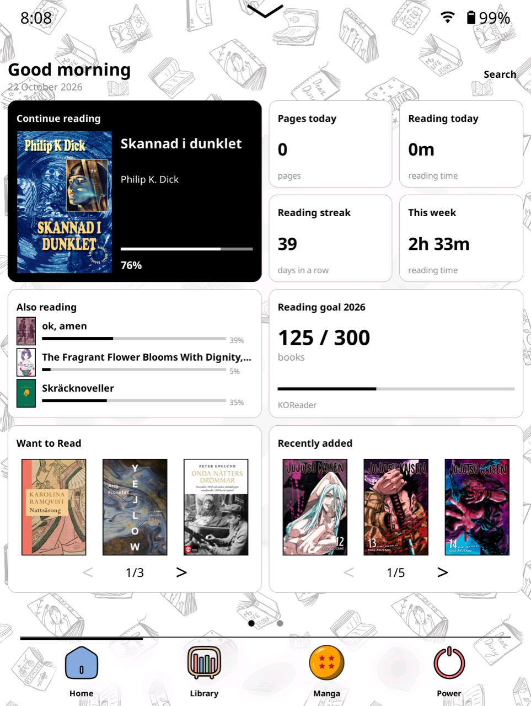
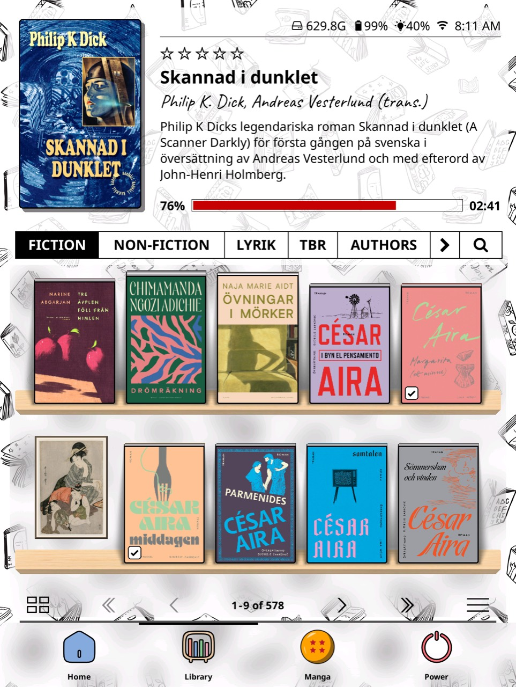

# OrbitUI for KOReader

**A customizable Home screen and a visual library, together in one KOReader plugin.**

OrbitUI combines **[SimpleUI](https://github.com/doctorhetfield-cmd/simpleui.koplugin)
by [doctorhetfield-cmd](https://github.com/doctorhetfield-cmd)** and
**[Bookshelf](https://github.com/AndyHazz/bookshelf.koplugin)
by [AndyHazz](https://github.com/AndyHazz)**, with their contributors' work.
These projects are the foundation of OrbitUI, not just inspiration: their code,
interfaces and features are included and adapted here. Please support and credit
the original creators.

**[Download Beta 5](https://github.com/komadorirobin/orbitui.koplugin/releases/tag/v0.1.0-beta.5)**
| [Install](#installation)
| [Switch from SimpleUI / Bookshelf](#already-using-simpleui-or-bookshelf)
| [Feature guide](docs/FEATURES.md)
| [Report a problem](https://github.com/komadorirobin/orbitui.koplugin/issues)

> **OrbitUI replaces the standalone SimpleUI and Bookshelf plugins.**
> You do not need to install either one first. If you already use one or both,
> disable them and restart KOReader before installing OrbitUI. Never run them
> alongside OrbitUI. Keep their files and settings for backup and rollback.

## Screenshots

| Reading dashboard | Book shelves | Manga series |
| --- | --- | --- |
|  |  |  |

Click a screenshot to view it full-size. This is an example **customized setup**,
not a fixed default: choose your own wallpaper, navigation buttons, sections and
layout. Ornaments are optional add-ons. The manga star ratings come from the
separate [MyAnimeList Manga Sync plugin](https://github.com/komadorirobin/myanimelist.koplugin).

## Why combine them?

SimpleUI provides a modular Home screen, reading statistics and navigation bars.
Bookshelf provides a visual library with shelves, covers, lists, series, book
details and themes. OrbitUI connects those experiences: go from your Home page
to a shelf, open the same book-detail panel from either place, pin shelves to
Home and search your library through one interface.

The aim is a coherent reading interface with **one installation, one settings
hub and one update channel**, while retaining the flexibility of both projects.
It is not a new reading engine, a replacement for KOReader itself, or an official
release by either upstream author.

## What you get

| Part | What it provides |
| --- | --- |
| **SimpleUI foundation** | Modular Home and Custom Screens, reading statistics/goals, navigation and quick actions, wallpapers and layout customization. |
| **Bookshelf foundation** | Visual shelves, cover grids and lists, book details, filtering/grouping, series boxes, themes and ornaments. |
| **Shared OrbitUI interface** | Connected Home/library navigation, shared book details and scoped search, shelf rows or carousels pinned to Home, and unified settings. |
| **Your own library structure** | Name and configure sections, folders, shelves and bottom-bar buttons. No required fiction/manga split or hard-coded personal folder setup. |
| **Optional Reading dashboard** | Continue reading, statistics, goals and book rows, with configurable cards, headings and sources. Each book row has arrows and swipe navigation. |
| **Shelf refinements** | Per-shelf cover size and captions, optional above-cover labels, Hardcover/Paperback/Kanzenban bindings, and aspect-preserving series covers with naturally sized spines. |
| **Optional ornament add-ons** | Browse, install and update packs inside OrbitUI, separately from plugin updates. Author/series matching is the default; random placement is also available. |
| **One update channel** | Verified full-plugin OTA updates with restart activation and code rollback. Embedded SimpleUI and Bookshelf do not update separately. |

These are additions and integration choices on top of substantial upstream
functionality, not a claim that OrbitUI invented the Home screen, library,
series boxes, themes or ornament system. [The feature guide](docs/FEATURES.md)
explains the extra controls and where to find them.

### Local books first, online services optional

You can use OrbitUI with ordinary local books, KOReader collections, local
reading goals and no online account. BookOrbit, Hardcover and MyAnimeList are
optional integrations, not requirements.

BookOrbit synchronization, MyAnimeList and Patch Manager remain separate
plugins where used. OrbitUI does not replace them, download your whole server
library or introduce a new synchronization engine.

### Choose the look

Keep each shelf's own settings, choose **Classic OrbitUI** for face-out books
and compact series boxes, or choose **Minimal bookshelf** without ornaments.
The Home layout is configured separately.

Ornaments are **not bundled or automatically installed** on a fresh setup.
Install only the packs you want through **OrbitUI settings > Add-ons >
Ornament add-ons**. Existing artwork is retained. Packs have their own credits
and licenses, including some noncommercial licenses; they are not all covered
by the code license. See [add-on instructions](docs/ADDONS.md).

## Installation

**Requirements:** KOReader **v2025.08 or newer**; v2026.03 or newer is recommended
by Bookshelf. Keep KOReader's **Cover browser** plugin enabled. Beta 5 is a
prerelease, not a promise of compatibility with every device or user patch.

1. **Back up first.** Keep a copy of your KOReader settings, user patches,
   custom artwork and working plugins. Preserve book sidecars/reading data
   separately too. See [backup details](docs/MIGRATION.md#what-is-preserved).
2. **If SimpleUI or Bookshelf is installed, disable it in KOReader's plugin
   manager and restart KOReader.** Disable both if you have both. Do not delete
   their settings or plugin folders.
3. Download **`orbitui.koplugin.zip`** from the
   [Beta 5 release](https://github.com/komadorirobin/orbitui.koplugin/releases/tag/v0.1.0-beta.5).
   Do **not** use **Code > Download ZIP** or GitHub's **Source code** archives.
4. Fully exit KOReader. Extract the ZIP and copy its **`orbitui.koplugin`**
   folder into your KOReader **`plugins/`** directory.
5. Start KOReader. Enable OrbitUI in the plugin manager and restart if needed.
   On a fresh setup, the guide helps you choose folders, a start screen and
   bottom-bar buttons. Nothing in the guide is applied until you confirm.
6. Open **Tools > OrbitUI > OrbitUI settings** to customize it. Existing
   SimpleUI/Bookshelf users keep their configuration rather than receiving an
   automatic setup prompt; open **Setup guide** manually when wanted.

Typical plugin locations (use the location of your actual KOReader installation):

| Device | Plugins directory |
| --- | --- |
| Kobo | `.adds/koreader/plugins/` |
| Kindle | `koreader/plugins/` |
| PocketBook | `applications/koreader/plugins/` |
| Android | `koreader/plugins/` in internal storage |

The resulting path must be **`plugins/orbitui.koplugin/main.lua`**, not
`plugins/orbitui.koplugin/orbitui.koplugin/main.lua`. Do not install the folders
under `components/` as separate plugins.

**Already using OrbitUI?** Use **Tools > OrbitUI > Uppdatera OrbitUI**
(the updater's current label), enable preview releases, update and restart.
Do not install SimpleUI or Bookshelf updates inside OrbitUI. For manual updates
of an existing OTA installation, read [the recovery guide](docs/OTA.md) first.

### Installing through a community app store

OrbitUI is discoverable by KOReader app stores through its GitHub repository
name and the `koreader-plugin` topic. These stores are independent projects;
being listed does not mean that their maintainers have reviewed or endorsed
OrbitUI. Their local catalogs may need refreshing.

**[AppStore by omer-faruq](https://github.com/omer-faruq/appstore.koplugin):**
after the backup and predecessor-disable steps above, find
`komadorirobin/orbitui.koplugin`. In its download options, choose
**Other releases...**, uncheck **Filter pre-releases**, select
**v0.1.0-beta.5**, then select **`orbitui.koplugin.zip`**. Restart KOReader
after installation. Beta 5 is not returned by GitHub's "latest stable release"
endpoint, so the default latest-release lookup may report that none exists.
Do not choose **Direct download from repo**, **Source code**, the checksum
file, or the add-on-only **ornaments-1** release.

**[Storefront by ultimatejimmy](https://github.com/ultimatejimmy/storefront.koplugin):**
use **26.10.20 or newer**, which includes the
[embedded-plugin detection fix](https://github.com/ultimatejimmy/storefront.koplugin/releases/tag/26.10.20).
Find `komadorirobin/orbitui.koplugin` and choose **v0.1.0-beta.5** and
**`orbitui.koplugin.zip`** from its versions/releases options if the cached
catalog still shows an older beta. Disable the predecessor plugins first as
described above. Older affected installers (including **26.10.17-beta2**) can
mistake embedded SimpleUI for the outer plugin and overwrite `simpleui.koplugin`;
use the manual ZIP instructions rather than those versions.

These instructions concern **first installation**. For subsequent OrbitUI
updates, **OrbitUI's own updater remains the recommended path**. Install Beta 2 or later
through it first: Beta 1 and earlier cannot detect an externally overwritten root
while an older OTA version remains active.

Beta 2 adds verified import of subsequently installed, newer external **release
ZIPs**, preserving the active OTA snapshot for rollback. An extra restart is
required to adopt the verified snapshot. Storefront also needs its own installer
fix as described above, and real-device testing of the external-import flow is
still pending. See [external-update compatibility](docs/OTA.md#external-updates-beta-2-and-later).

In-app ornaments are managed separately under **OrbitUI settings > Add-ons**.
Their [distribution repository](https://github.com/komadorirobin/orbitui-addons)
is separate from plugin releases. Existing packs and settings are preserved;
older catalog downloads remain available for previous OrbitUI versions.

## Already using SimpleUI or Bookshelf?

**Your existing data is not intentionally wiped or moved.** OrbitUI reuses
SimpleUI's settings and recognizes both the older and current Bookshelf settings
locations. It reads existing ornament folders in place. Normal preference edits
use the selected existing stores, rather than a separate one-time imported copy.

Before its first component startup, OrbitUI also makes a **limited settings
snapshot** in `settings/orbitui/before-first-run/`. A failed snapshot blocks
startup. This is **not a full backup**: ornament images, wallpapers, books,
sidecars, databases and other plugins' settings are not copied by that snapshot.

If both old and new Bookshelf settings files exist, the older flat location
wins to protect existing OrbitUI installations. The other copy is left untouched,
not merged. Read [the migration guide](docs/MIGRATION.md) before proceeding if
you have two different configurations.

Existing Home pages and configured integrations are retained. OrbitUI-specific
options and later upstream setting formats may not be understood by older
standalone versions. Visual behavior can differ; custom patches are not
guaranteed compatible. For rollback, **disable OrbitUI and restart before
re-enabling your old plugins**. Never restore stale reading-progress files just
to undo a UI change.

## Beta status and feedback

Local maintenance after Beta 5 includes reviewed Bookshelf **6.0.0** and newer
SimpleUI **3.0** Git commits. It is not yet published as an OrbitUI update;
the public Beta 5 download below is unchanged. See [the merge log](docs/MERGE_LOG.md).

**0.1.0-beta.5** integrates **SimpleUI 3.0** from its reviewed official release
ZIP: detailed statistics/charts, live Bento layout preview, accent colours,
optional fonts and Tiny Critter. Existing percentage/stacked layouts and OrbitUI
defaults are retained; the new fixed-span layout is activated per screen by an
explicit width/movement edit. The release asset differs from SimpleUI's Git tag;
provenance and later Git reconciliation are documented in
[the upstream workflow](docs/UPSTREAM.md).

Bookshelf remains 5.5.5 with its subsequent Shelf size crash fix. The existing
reader setup, upgrades and
ornament menu were tried on the maintainer's device before Beta 1. Automated
tests cover both Lua and LuaJIT, integration, packaging and the OTA installer,
including Beta 2's external-update snapshots and rollback. The new external
installation/restart flow and the new SimpleUI 3.0 surfaces still need
physical-device testing. This is not an
exhaustive device/fresh-install compatibility certification.

Please report your device, KOReader version, OrbitUI version and steps to
reproduce a problem in [OrbitUI issues](https://github.com/komadorirobin/orbitui.koplugin/issues).
Report integration problems here first, not as presumed bugs in SimpleUI or
Bookshelf. Redact tokens, account details and private paths from logs; do not
upload settings backups.

## Credits and licenses

- **SimpleUI:** [doctorhetfield-cmd and contributors](https://github.com/doctorhetfield-cmd/simpleui.koplugin),
  [GPL-3.0 license](components/simpleui/LICENSE). The original MIT notice is
  [retained](components/simpleui/LICENSE-MIT-ORIGINAL.txt) for previously imported code.
- **Bookshelf:** [AndyHazz and contributors](https://github.com/AndyHazz/bookshelf.koplugin),
  [AGPL-3.0 license](components/bookshelf/LICENSE).
- **OrbitUI integration and customizations:** [komadorirobin](https://github.com/komadorirobin),
  [AGPL-3.0](LICENSE). This is an independent project, not an upstream endorsement.
- **Icons and artwork:** their original creators retain credit and separate
  licenses. See [icon credits](docs/ICONS.md) and each ornament pack's
  **Credits and licenses**. Free download does not make every asset public domain.

Both component licenses, notices and imported Git histories are retained.
Beta 5 integrates Bookshelf **5.5.5** and SimpleUI **3.0**; exact imported and
reviewed upstream revisions are recorded in [sources.json](sources.json).
Upstream updates are reviewed and merged, not automatically installed.

## Development

Run `sh scripts/test.sh` and `LUA=luajit sh scripts/test.sh`, then
`sh scripts/check-translations.sh`. Build a runtime ZIP from a clean committed
revision with `sh scripts/package.sh`.

Integration code lives in `core/` and `adapters/`; the original components live
under `components/`. See the [project context](docs/PROJECT_CONTEXT.md),
[integration contracts](docs/INTEGRATION_CONTRACTS.md),
[upstream workflow](docs/UPSTREAM.md), [merge history](docs/MERGE_LOG.md),
[testing](docs/TESTING.md) and [OTA/recovery](docs/OTA.md).
The upstream watcher reports changes only; it never merges or publishes.
